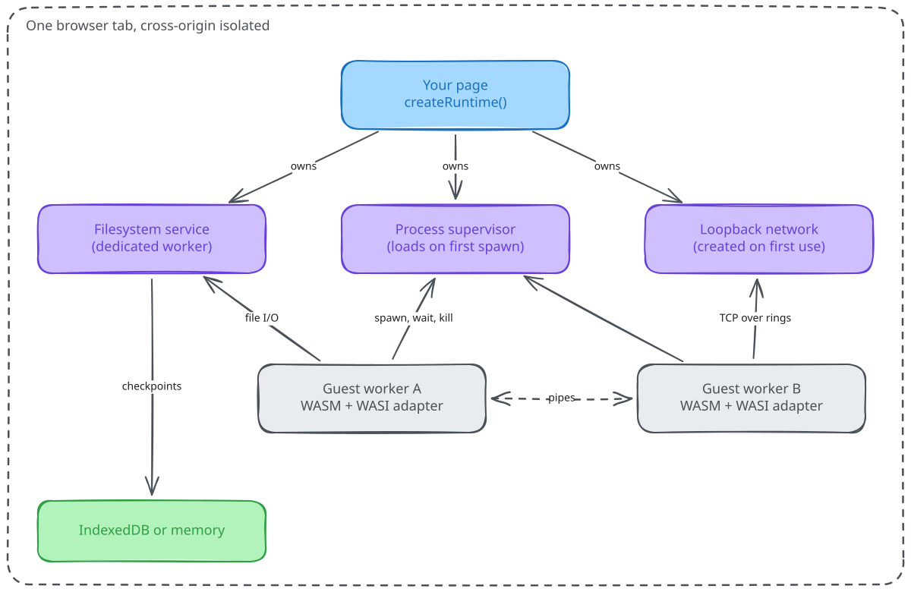
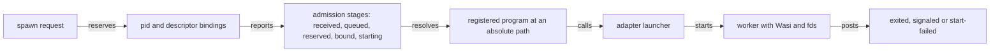

# How Waffle works

Waffle is a set of services that one page owns and many guest programs borrow. This page explains who owns what, how a spawn travels through the runtime, and why a few rules that look strict are there. It describes the design. For exact signatures and error codes, use the [reference](README.md#reference).

<picture>
  <source media="(prefers-color-scheme: dark)" srcset="assets/waffle-overview.dark.svg">
  
</picture>

Arrows from the page mean "owns and disposes". Arrows from the guests mean "borrows".

## One runtime per page

`createRuntime()` returns the only runtime a page may have. A second call while the first is alive throws `A live page runtime already owns this page`. A guest or a shell that wants a filesystem asks the runtime it was given. It never builds another one.

The rule exists because the filesystem, the pid space and the network namespace are shared state. Two owners would mean two trees, two pid counters and two loopback networks. Borrowing gives the question "whose filesystem is this?" one answer.

Disposal follows the same ownership. `Runtime.dispose()` first fences filesystem work that was already admitted. It stops guest consumers only after that work is quiet, then closes the services it owns, and last releases the one-runtime guard. A guest cannot dispose the runtime it borrows, because the capabilities it receives leave out `dispose`.

## What the runtime owns

**Filesystem service.** A dedicated worker owns the file tree in shared memory. The runtime grows it in 64 KiB pages inside 16 MiB growable `SharedArrayBuffer` segments, with a 1 GiB resident pool by default. A guest reads and writes pages directly with no message to the service when capacity is already allocated. Path changes and growth still go through the service. The `mode` you pick chooses what backs the tree. [Filesystem modes](vfs.md) lists them.

**Process supervisor.** It tracks pids, jobs, signals and exit outcomes, and it holds the registry that maps `/bin/name` to a compiled module and an adapter. Each process gets its own worker. The supervisor loads on the first spawn, so a page that only needs a filesystem never pays for it.

**Pipes.** A pipe is a ring of shared memory with one producer lane per writing process. A write that completes before another write starts is ordered before it, even across processes.

**Loopback network.** `await runtime.network()` creates it on first use. Listeners and sockets live in a virtual loopback owned by the runtime, so guests in different workers reach each other on `127.0.0.1` without leaving the page. There is no route to a real interface. [Networking](network.md) has the contract.

**Interruption.** WebAssembly has no way to preempt a loop. For source bytes, Waffle's rewriter inserts checkpoints so a signal can stop a CPU-bound guest. A precompiled module skips that step and must declare `cooperative: true`.

## The life of a spawn

A spawn is a reservation first and a launch second. The first half is synchronous so a blocked guest gets a pid without waiting for the page. The second half is asynchronous.

The reservation snapshots argv, environment and working directory and retains the descriptors the child will inherit, so the parent can close them right away. Admission then walks the real filesystem tree to the registered path, which is why a missing file gives `ENOENT` and a directory gives `EACCES`. The adapter you registered decides what "launch" means. The bundled `preview1` worker runs a plain WASI command. Bun's adapter runs Bun compiled to WebAssembly. The `launching` and `launched` admission events mark the adapter's entry and exit, and a reservation alone is not proof that anything started.

## Why a kill takes two steps

Killing a process first selects its outcome, for example `signaled` with 137 for `SIGKILL`, and revokes its descriptors. Terminating the worker comes later, after the filesystem confirms that nothing the guest started is still inside a critical section. The delay is deliberate. A worker killed while it holds a filesystem lock would leave that lock held forever, and every other guest would hang. The cost is that "the process is dead" and "the worker is gone" are two moments. Waffle never hands a killed process's buffers to another process.

## Why guests block

A guest call such as `fd_read` has to return a value to WebAssembly code that cannot await. A worker can block on `Atomics.wait` until a service writes the answer into shared memory, so Waffle does that and keeps Preview 1 semantics intact. The cost is placement. Any thread that serves a blocked guest must stay responsive, so the page's main thread cannot be a guest, and a network helper cannot share a thread with the guest it serves. Firefox adds a rule of its own. Creating a `MessageChannel` in a blocked guest would deadlock it, so a guest that spawns a child creates only an identity and lets the page attach the channel.

## What a guest can and cannot touch

Guest JavaScript shares a worker realm with Waffle's adapter code. After startup it can replace globals, prototype methods and iterator hooks. So the rule is about where authority goes: Waffle never passes a process directory, a pipe buffer or a descriptor table through a builtin that guest code can replace, and it captures native functions before any guest code runs. [Private process authority](private-authority.md) states the rule and lists what counts as authority. Waffle makes no claim of a security audit. Treat it as pre-1.0 software when it runs code you do not trust.

## Where to go next

- [Run a WASI program](guides/run-a-wasi-program.md) puts the spawn flow into code.
- [Architecture and API notes](architecture.md) is the reference for processes, pipes and the shared filesystem.
- [Host ABI](host-abi.md) lists every import a guest can call.
- [Decisions](README.md#decisions) records why the shape is this way.
