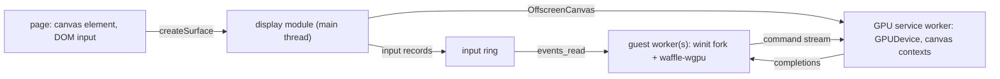

# Guest graphics: windows, WebGPU and wgpu

Status: **Proposed plan family. Nothing here is implemented or approved.**

Prepared: 2026-10-31. Inspected Waffle baseline
[`9b66e3aa2462771f65ca263745a23c80e2c8fea3`](https://github.com/ShaulLavo/waffle/commit/9b66e3aa2462771f65ca263745a23c80e2c8fea3)
and Horizon
[`4e833c2fe6cfec9698cff687ded95208e8871061`](https://github.com/horizon-rust/horizon/commit/4e833c2fe6cfec9698cff687ded95208e8871061).

Waffle runs WASI programs that read files, spawn processes and talk over loopback. This family
lets them open a window and draw with the GPU, so a desktop Rust app built on winit and wgpu can
run in a tab with its event loop and renderer unchanged.

| Plan                                  | Owns                                                                                                   | Language |
| ------------------------------------- | ------------------------------------------------------------------------------------------------------ | -------- |
| [Windows and input](guest-windows.md) | `runtime.display()`, surface grants, the input ring, `runtime_window`, `waffle-window`, the winit fork | TS, Rust |
| [WebGPU bridge](gpu-bridge.md)        | The GPU service worker, `runtime_gpu`, the WebGPU command stream and completions                       | TS       |
| [wgpu backend](wgpu-backend.md)       | `waffle-wgpu`: wgpu's `custom` backend over the stream, and the wgpu `Send`/`Sync` patch               | Rust     |

The first consumer is [Horizon](#first-consumer-horizon), a Rust rewrite of a large voxel game.

## How the pieces fit

The page owns the canvas, the display module and the GPU service. A guest process borrows a surface
grant. Its winit event loop blocks in `events_read`; its wgpu calls become stream records the GPU
service replays. Neither the canvas nor any WebGPU object enters guest JavaScript.

## Where the code lives

Waffle needs only the interface. Libraries that call it compile into guest programs and never enter
a Waffle bundle, so they live outside this repository, as Bun's adapter and Bash Web already do.
No exception to the TypeScript rule in `AGENTS.md` is needed.

| In this repository                                                                                                                                               | In a separate repository (name to be chosen)                                                                                                                         |
| ---------------------------------------------------------------------------------------------------------------------------------------------------------------- | -------------------------------------------------------------------------------------------------------------------------------------------------------------------- |
| Page-side TypeScript: the display module and the GPU service                                                                                                     | `waffle-window` and `waffle-gpu-sys` (bindings generated by wit-bindgen plus a thin safe layer), `waffle-wgpu`, and later socket helpers ([networking](#networking)) |
| The WIT for `runtime_window` and `runtime_gpu` ([interface definition](#interface-definition-wit-now-standards-later)) and their contracts in `docs/host-abi.md` | The winit fork, as a branch based on `v0.30.13`                                                                                                                      |
| The stream's opcode and record table as a data file that clients generate code from ([wire format](gpu-bridge.md#wire-format))                                   | Tests of those crates against a pinned Waffle                                                                                                                        |
| Small C and Rust guest fixtures for Waffle's own tests (allowed today as "guest fixtures", see [guest threads](wasi-threads.md))                                 |                                                                                                                                                                      |

Interface changes follow `AGENTS.md`: change matching consumers together, no compatibility
negotiation, and a `waffleHostInterface` bump when an old client cannot run on the new contract.
The guest crates keep `rust-version` at or below the oldest supported consumer toolchain (Horizon
needs 1.95).

## Interface definition: WIT now, standards later

Component Model support is a separate lane from [guest threads](wasi-threads.md), and the two do
not have to meet. A core module, including a `wasm32-wasip1-threads` program such as Horizon, can
import functions with canonical-ABI signatures generated by wit-bindgen without being a component.
Waffle can therefore define these interfaces in WIT and serve them to threaded Preview 1 programs.

- **Define the interfaces in WIT.** Rust bindings come from wit-bindgen instead of handwritten
  `-sys` crates. Waffle's side uses the adapter that [#286](https://github.com/ShaulLavo/waffle/issues/286)
  evaluates, so it stays demand-loaded and keeps Waffle's owners and capabilities.
- **Follow the standards where they fit.** `runtime_window` is compared against
  [`wasi-gfx:surface`](https://github.com/wasi-gfx/wasi-gfx); the GPU calls follow
  [`wasi:webgpu`](https://github.com/WebAssembly/wasi-webgpu) semantics (copy-based mapping, error
  scopes, device loss). Where a standard shape fits, use it as is, so the same backends can run
  on other hosts.
- **Keep the binary stream for the hot path.** Rule: a call that returns data to the guest is a WIT
  function; a one-way call (creation, release, queue writes, recorded command buffers, present)
  is a record in the [stream](gpu-bridge.md#wire-format), appended through one WIT function that
  takes `list<u8>`. One canonical-ABI call per WebGPU call would put thousands of wasm-to-JS
  crossings in every frame.
- **No round trip for handles.** Imports run in the guest's own worker, so the adapter mints
  resource handles locally and enqueues the creation. WIT resources do not force a trip to the GPU
  service.
- **Not adopted as is:** `wasi:webgpu` 0.3.0-rc uses Preview 3 async functions, and Waffle's guests
  block. Waffle's WIT keeps the standard's shape with synchronous calls; the difference is limited
  to those async calls.

### First experiment: issue #286

`runtime_window` is the candidate for [#286](https://github.com/ShaulLavo/waffle/issues/286). It
carries a resource (the surface grant) with real lifetime and revocation rules, its call rate is
modest, and it has a Rust consumer (the winit fork) and a C fixture. The experiment writes it in
WIT, compares that with `wasi-gfx:surface`, generates the Rust bindings, serves them through the
#286 adapter, and measures against a handwritten version of the same calls: loaded bytes, the cost
of a blocking event read, release after revocation and kill, and toolchain needs.

If #286 adopts it, the GPU calls that return data follow the same route. If it defers or rejects,
the handwritten imports in the [window](guest-windows.md#guest-abi-runtime_window) and
[GPU](gpu-bridge.md#guest-abi-runtime_gpu) plans stand, and the record formats are unchanged
either way.

### When the stack can move to the standards entirely

All of these must hold:

1. Waffle runs components (its separate lane) and serves `wasi-gfx:surface`, `wasi:webgpu` and
   `wasi:sockets`.
2. Components have threads (the shared-everything threads proposal) and Rust has a matching target,
   so threaded apps like Horizon can be components.
3. `wasi:webgpu` and `wasi-gfx` are stable, and their async calls either have synchronous forms or
   Waffle can run Preview 3 async in blocking guests.
4. winit and wgpu have backends for those interfaces: ours retargeted, upstreamed, or replaced.

Then apps compile for a standard target with no Waffle-specific crates, and the guest-crates
repository is retired. Until then, an adapter can lower `wasi:webgpu` calls into the stream.

## Order of work

Two lanes can start now, without [guest threads](wasi-threads.md):

1. **Windows:** W0 → W1 → W2 → W3 → W4 ([slices](guest-windows.md#delivery-slices-and-effort)).
2. **GPU:** G0 → G1 → G2 → G3 ([slices](gpu-bridge.md#delivery-slices-and-effort)), with B0 → B1
   → B2 of the [wgpu backend](wgpu-backend.md#delivery-slices-and-effort) starting after G1.

Everything single-threaded is testable with wgpu's own examples on `wasm32-wasip1`. Once threads
reach S4, W5 and B3 finish the threaded paths, and Horizon can boot.

| Lane              | Engineer-days | Depends on               |
| ----------------- | ------------- | ------------------------ |
| Windows W0–W4     | 17–27         | Nothing new              |
| GPU G0–G3         | 22–34         | Nothing new              |
| wgpu B0–B2        | 17–26         | G1, G2, W2 (surface ids) |
| Threaded W5, B3   | 6–10          | Threads S4               |
| Release G4–G5, B4 | 14–24         | All of the above         |

## First consumer: Horizon

Horizon is a Rust rewrite of a large voxel game: about 850,000 lines, wgpu 30, winit 0.30, many
threads (a server thread, chunk generation, meshing, lighting, LOD, networking). Single player
already runs its world on a server thread that the window joins through memory, not TCP.

### What builds today

Measured on 2026-10-31 with Rust 1.95, target `wasm32-wasip1-threads`, wasi-sdk's threads sysroot
as the C compiler, and `cargo build -p horizon-client --no-default-features --keep-going`:

- Build unchanged: `horizon-core`, `horizon-world` (world generation and block rules, about 174,000
  lines), `horizon-protocol`, `horizon-assets`, `horizon-command`, `horizon-items`,
  `horizon-client-core`, and the C and OS dependencies `ring`, `rustix`, `fs4`, `ureq`, `flate2`, `zip`.
- `horizon-threads` builds after swapping mimalloc for the system allocator on WASI (a few lines).
- Fail: `winit` (no platform), `horizon-hdr` (Vulkan internals), `arboard` (no clipboard
  platform), `socket2` and `if-addrs` (used by Horizon's direct-connect code).
- `wgpu` compiles but has no backend, so it would find no adapter.

### What Horizon would change

All behind `cfg(target_os = "wasi")`, kept small enough to upstream:

- `[patch.crates-io]`: the winit fork, and `wgpu` plus `wgpu-types` with the
  [`Send`/`Sync` patch](wgpu-backend.md#send-and-sync-on-wasi-with-threads-blocking).
- `horizon-client-render/src/gfx.rs:1185`: `waffle_wgpu::instance()` instead of `Instance::new`.
- `horizon-threads`: system allocator; `horizon-hdr`: excluded.
- `horizon-client-input/src/clipboard.rs`: `SystemClipboard` backed by `waffle-window`'s clipboard
  slot instead of arboard. The existing `Clipboard` trait already isolates it.
- Gamepads (`controllers` feature) and audio (`cpal`) off at first. Audio needs its own plan
  (an AudioWorklet fed from shared memory).
- Game files: `horizon-prepare` runs Java, so the player prepares files on a desktop and imports
  the prepared folder into the Waffle filesystem. No game assets are hosted.

### Measure before promising

- **Memory.** The threads plan keeps 32-bit memory, so every thread shares at most 4 GiB. Horizon
  will need a low default render distance in the browser. Measure peak memory natively first.
- **Thread count.** `std::thread::available_parallelism` on this target calls wasi-libc's
  `sysconf(_SC_NPROCESSORS_ONLN)`. The threads plan should make it report the runtime's
  parallelism, or Horizon sizes its pools for one core.
- **GPU stream volume.** Horizon issues thousands of draws per frame and blocks on an error scope
  per section-buffer allocation. Bridge slice G4 replays a captured Horizon frame.

## Networking

Sockets stay on. Waffle's relay (`packages/waffle-relay`, outbound HTTP today, with TCP and
WebTransport planned) gives guests a route out. Horizon on Waffle then needs:

- **A socket interface for plain Preview 1 commands.** `std::net` on `wasm32-wasip1` cannot
  connect or listen, and Preview 1 `sock_*` calls return `ENOTSUP` in Waffle today; TCP reaches
  only adapters such as Bun's. Following the [WIT direction](#interface-definition-wit-now-standards-later),
  Waffle would serve `wasi:sockets` over the existing `NetHost` ring to core modules. A threaded
  Rust program still cannot use `std::net`, because Rust's standard library on `wasm32-wasip1`
  does not call `wasi:sockets`, so Horizon needs a small `TcpStream`/`TcpListener`-shaped wrapper
  over the standard `wasi:sockets` bindings rather than a Waffle-only API. Single-threaded programs
  on `wasm32-wasip2` get `std::net` directly once Waffle runs components. Whether core modules can
  link the standard bindings unchanged is to be verified. This belongs to the network and relay
  lane; this family only depends on it.
- **Loopback inside the page.** Horizon's play-with-friends tunnel connects to local loopback
  ports. Waffle's virtual loopback already carries that between workers.
- **Outbound TCP through the relay** for joining servers and for Horizon's own `horizon-relay`
  fallback, which carries play-with-friends for both host and guest over outbound TCP. That makes
  hosting a world for friends possible from a tab.
- **What stays off in a tab:** LAN discovery (UDP multicast), STUN, and router port mapping
  (PCP, NAT-PMP, UPnP). They describe the real local network, which a tab cannot reach.
  Horizon's direct-connect path (`socket2`, `if-addrs`) is compiled out on WASI and the relay
  path is used instead. WebTransport datagrams could carry other UDP later.
- **DNS.** Horizon resolves server SRV records itself (`horizon-protocol/src/resolver/dns.rs`).
  In a tab, names resolve at the relay.

## Open questions for the owner

1. Name of the guest-crates repository: the winit fork, the wgpu backend and the generated
   bindings that programs running on Waffle compile in. Suggested: `waffle-rs`.

## Decided

All by the owner on 2026-10-31.

- **The stream stays usable by a C `webgpu.h` client.** Opcodes and records follow WebGPU, not
  wgpu, and are generated from `webgpu.yml` ([wire format](gpu-bridge.md#wire-format)).
- **Guest Rust crates live outside this repository.** Waffle owns the interface, its data table and
  fixtures ([where the code lives](#where-the-code-lives)). Replaces the earlier proposal for an ADR
  allowing Rust guest crates here.
- **The winit fork lives in the guest-crates repository**, next to `waffle-window`. Not vendored
  here: winit 0.30.13 is about 57,000 lines of upstream Rust for a patch of about 2,000.
- **Interfaces are defined in WIT where it fits**, served to threaded Preview 1 programs as core
  imports, with `runtime_window` as the [#286](https://github.com/ShaulLavo/waffle/issues/286)
  experiment and the binary stream kept for one-way GPU calls
  ([interface definition](#interface-definition-wit-now-standards-later)). Adoption beyond the
  experiment follows #286's decision.
- **One GPU service per runtime, one isolated connection per process**, from
  [prior art](gpu-bridge.md#prior-art). Bridge slice G0 still measures it; a failed measurement
  reopens this decision.
