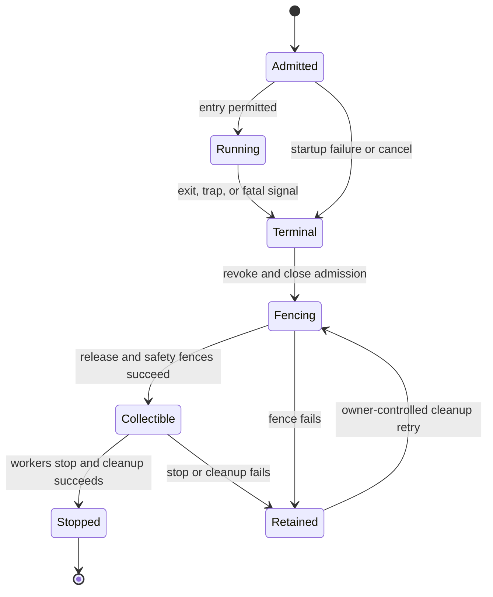

# Native guest threads in the browser

Status: **Approved implementation plan. This change delivers no runtime thread support.**

Prepared: 2026-10-31. Inspected Waffle baseline:
[`5ffb379b14e129e6505b499d91aa743cd80b3d38`](https://github.com/ShaulLavo/waffle/commit/5ffb379b14e129e6505b499d91aa743cd80b3d38).
Implementation owner: runtime/process lane, to be assigned with an independent reviewer before
source work. Coordinate exact source ownership with other active lanes. Estimates are engineering
judgments; browser performance and memory profiles have not been measured by this plan.

## Goal and supported boundary

Run statically linked WASI Preview 1 commands compiled for threads: initially Rust
`wasm32-wasip1-threads` and C with wasi-libc pthreads. Spawn, join, TLS, shared-memory synchronization,
and supported blocking system calls from secondary threads must work in Chrome, Firefox, and
Safari, including actual iPhone Safari. Use one page-owned runtime and browser execution only.

Implement `wasi.thread-spawn`, one shared Wasm memory per process, and one Worker/instance per live
thread. Preserve synchronous guest calls, independently responsive services, process outcomes,
pipe ordering, filesystem lock safety, and lazy loading. Single-threaded programs retain their
existing execution path and do not acquire a thread pool.

The first production target is the bundled Preview 1 command worker. Custom executors require an
explicit thread-capable adapter contract and separate qualification. Emscripten-generated apps,
emnapi/Node-API wrappers, and Bun's engine/network adapter do not automatically become compatible
with the generic WASI loader. Thread support also does not supply missing native OS APIs or Rust's
WASI `std::process::Command` backend. See [research and references](wasi-threads-references.md).

Defer shared-everything/component-model execution, asynchronous `pthread_cancel`, POSIX per-thread
signals/masks, memory64, multi-memory guests, new dynamic-linking guarantees, and reuse of Workers
that already executed guest code. No allocator or Rust-standard-library fork is required. Do not
add version negotiation, old-shape fallbacks, version bumps, or new GitHub issues for this plan.

## Recommended decisions

| Area               | Decision                                                                                                                                  | Reason / cost                                                                                                         |
| ------------------ | ----------------------------------------------------------------------------------------------------------------------------------------- | --------------------------------------------------------------------------------------------------------------------- |
| ABI                | Optional `wasi.thread-spawn` adapter over a generic host thread controller.                                                               | Fits the requested Rust/C producers; keeps the legacy ABI replaceable.                                                |
| Identity           | One PID, outcome, job membership, descriptor namespace, and authority for the thread set.                                                 | Threads are not child processes or memory-group member processes.                                                     |
| Memory             | Stock guest allocator; ordinary shared memory; owner-mediated append-only backing growth for prepared bytes.                              | Correct admission before allocation, with a control round trip on expansion.                                          |
| Precompiled inputs | Explicit interruption cooperation and memory-accounting admission. Reserve the complete configured ceiling when growth is uninstrumented. | An opaque `WebAssembly.Module` cannot be rewritten; cooperation with interrupts says nothing about growth accounting. |
| Files              | Process-owned descriptor/lifetime metadata, shared binding records, per-thread borrowed views and filesystem connections.                 | Correct close/dup/offset semantics while preserving direct regular-file I/O.                                          |
| Streams            | Broker threaded pipe/opaque endpoint operations initially, with nonblocking service execution.                                            | Avoids synchronously delivering new JS endpoint objects to blocked workers; adds scheduling overhead.                 |
| Guest waits        | Allow native atomic waits in the supervised threaded path; retain CPU checkpoints.                                                        | Preserves wait/notify semantics; process kill does not require a parked guest to cooperate.                           |
| Fatal exit         | Select one outcome, revoke, fence every admitted origin, then stop all Workers.                                                           | Extends the existing two-step kill.                                                                                   |
| Worker capacity    | One Worker per admitted live thread; per-process and runtime caps include pending startup.                                                | A successfully created pthread queued behind blocked workers can deadlock a join/barrier.                             |
| Worker reuse       | Fresh or never-used prewarmed Workers first.                                                                                              | Avoids TLS, instance state, and delayed callbacks leaking across logical thread lifetimes.                            |

## Modularity and when code loads

Thread support is a lazy runtime feature, not an eagerly initialized part of every process. The
production default should discover the need from validated program requirements and load the
feature automatically; an application should not have to register a plugin to run a supported
threaded command. An explicit host policy may disable the feature and reject such commands clearly.

| Point in execution                               | What becomes available                                                                                                                                | What remains unallocated                                                                           |
| ------------------------------------------------ | ----------------------------------------------------------------------------------------------------------------------------------------------------- | -------------------------------------------------------------------------------------------------- |
| Page creates its runtime                         | Existing runtime facade and services selected by the page.                                                                                            | Process implementation still follows its existing first-spawn boundary; no thread feature or pool. |
| Ordinary single-threaded command loads           | Existing local descriptors, WASI adapter, preparation, and one process Worker.                                                                        | Thread controller, shared-FD implementation, thread control arenas, and thread Workers.            |
| Validated requirements select threaded execution | Dynamically import the thread feature before guest entry; create this process's shared backing, descriptor/control state, and initial-thread context. | Additional guest Workers and their connections until admitted spawn.                               |
| Guest calls `wasi.thread-spawn`                  | Reserve and create the additional Worker/instance, thread request state, and filesystem connection.                                                   | Further threads until requested; used-worker recycling remains deferred.                           |

The load trigger is the selected execution contract, not merely a file name or Rust target label.
Required synchronous imports and shared-memory behavior must be ready before instantiation/guest
entry. A binary compiled for threaded execution can therefore pay the feature setup cost even if
its particular run never spawns a child. Deferring promotion of a live local FD table until the first
spawn adds another migration protocol and is not part of the initial design.

Keep the full thread ABI, controller, record layouts, shared descriptor implementation, and managed
growth support behind an explicit dynamic import. Small generic integration hooks remain in program
admission, rewrite policy, descriptor selection, and process quiesce/stop. The threaded controller
supplies its aggregate lifecycle behavior through those hooks; the ordinary controller and local
descriptor implementation keep their current behavior. Type-only dependencies must erase, and
barrel reexports must not accidentally pull the feature into the common runtime graph.

Use a separately loadable child-worker entry or a lazy role-specific adapter in the existing entry.
Keep the coordinator responsive while chunks load, and capture required authority-bearing natives
before guest execution. A feature-chunk load error fails admission through the normal owned cleanup
path. Threading must not create another runtime or a per-process service Worker.

Update the source package file list, subpath exports where needed, and `packages/waffle/build.ts`
module-emission list together so lazy modules work in source-first browser builds and prepared Node
exports. Merely placing files in a new directory is not a modularity guarantee.

Acceptance must verify both the bundler import graph and cold browser request graph: ordinary
commands do not fetch/evaluate the thread feature or allocate its arenas/Workers; threaded commands
load it before entry and share it through the existing runtime; later spawns allocate only admitted
per-thread resources. Measure base/core, lazy-thread chunk, and per-worker costs separately. Tiny
generic-hook bytes may remain in common code; promise no eagerly loaded thread implementation or
thread-only resources, not literally zero additional bytes in every common module.

## Delivery slices and effort

Assume one engineer familiar with Waffle, reviewer support, and real iPhone access. Estimates include
implementation and focused verification. They exclude application ports, Emscripten/Node-API
compatibility, a Rust process backend, and major browser-engine investigations. Parallel fixture and
device work can help, but shared ownership and shutdown changes have a common critical path.

| Slice                       | Rough effort      | Deliverable and exit gate                                                                                                                                                                                                                                                   |
| --------------------------- | ----------------- | --------------------------------------------------------------------------------------------------------------------------------------------------------------------------------------------------------------------------------------------------------------------------- |
| S0. Smallest proof          | 3–5 engineer-days | Pin coherent Rust/C producers. Through an isolated Waffle experimental worker path, spawn/join one child using small fixed shared memory. Verify shared results, distinct TLS/stacks, and parent-blocked startup in the three browser families and a real iPhone smoke run. |
| S1. Process state           | 6–10 days         | Thread records under one process controller; shared descriptor/open-description state; process-owned query/watch/child namespaces; separate per-thread request connections. Prove creator-thread exit does not destroy shared resources and close/reuse is coherent.        |
| S2. Lifecycle and kill      | 5–8 days          | Ready/commit/start handshake, startup rollback, normal return, process-wide exit/trap/kill, all-origin filesystem/adapter fences, and retained failure debt. Prove another process can keep using the filesystem after kills at every lifecycle stage.                      |
| S3. Managed memory          | 4–7 days          | Compatible smaller maxima; growth preparation and owner transaction; cross-agent view refresh; precompiled admission; aggregate backing and Worker policy. Prove simultaneous growth, denial/refund, and kill/grow races.                                                   |
| S4. Solid runtime milestone | 4–6 days          | Qualify real Rust/C nested spawn, join/detach, TLS, mutex/condvar, channels, Rayon, panic/abort, limits, and services. Run established single-threaded regressions and account for every retired/retained resource.                                                         |
| S5. Browser release         | 8–14 days         | Repeated command/kill qualification, device resource envelope, throughput/UI measurements, selected defaults, diagnostics, public documentation, and matching consumer integration.                                                                                         |

S0–S4 total **22–36 engineer-days (roughly 4.5–7.5 engineer-weeks)**. Through S5 the estimate is
**30–50 days (roughly 6–10 weeks)**, with additional time possible for browser failures or a broader
descriptor refactor. These totals are cumulative, not extra weeks to add to each row. Re-estimate
after S0 and after the shared binding/lifetime protocol review.

S0 proves the embedding model; it does not establish safe concurrent filesystem access, complete
process teardown, mobile memory policy, or production admission. Keep it isolated and experimental.
The maintained solid milestone requires S1–S4 correctness, including stock allocator growth and
all-thread kill. Keep threaded admission experimental until those gates pass. S5 establishes the
supported device profiles and release claim.

Suggested focused implementation PR boundaries: feature inspection/fixtures; thread records and
bootstrap; shared bindings/lifetimes; remaining process-owned namespaces; terminal/fence protocol;
managed growth and views; producer qualification; browser/policy/docs. Do not combine descriptor
ownership, a new allocator, and used-worker pooling into one review.

### Required design records

Each slice produces a checked-in decision record or fixture manifest before its dependent work
starts. Assign its author and independent reviewer with that slice's source ownership. Record the
choice, alternatives, evidence, and acceptance command; do not leave a correctness requirement as
an implementation assumption.

- S0 records exact Rust/C compiler, SDK, sysroot and CRT versions, build flags, imports/features,
  memory requirements, artifact hashes, and the browser/device identities used by its proof.
- S0 measures cold source preparation in its actual calling realm. Separate byte acquisition,
  hashing, synchronous rewriting, engine compilation, and page scheduling gaps. The current
  asynchronous loader still runs its JavaScript rewrite synchronously before compilation. Decide
  from those results whether preparation stays there or needs a separate worker; asynchronous
  compilation alone is not evidence that preparation leaves the page responsive. Keep the chosen
  ownership, cache, cancellation and lazy-loading requirements intact.
- S1 settles the shared descriptor record layout and state transitions, publication and close
  linearization points, generation exhaustion, operation-pin release, and last-reference
  reclamation. Deterministic interleaving tests must pass before workers use that protocol.
- S3 defines the thread-policy API, units, refusal categories, and count rules for pending/live
  threads, prewarmed/helper workers, backing charges and retained debt. Unmeasured trial values are
  not release defaults.
- S5 records the supported device/OS floor, measured profiles, release caps, responsiveness
  thresholds, and remaining limitations. Select them from the baseline and repeated device runs
  rather than treating the trial matrix as a supported envelope.

## Existing foundations and source map

Read [concepts](../docs/concepts.md), [host ABI](../docs/host-abi.md),
[architecture](../docs/architecture.md), [memory groups](../docs/memory-groups.md), and
[private authority](../docs/private-authority.md). Relative links below refer to this checkout;
the inspected revision is pinned above.

| Area                                                                                                                                                                                                                                                 | Reuse / extend                                                             | Required distinction                                                                                          |
| ---------------------------------------------------------------------------------------------------------------------------------------------------------------------------------------------------------------------------------------------------- | -------------------------------------------------------------------------- | ------------------------------------------------------------------------------------------------------------- |
| [`runtime.ts`](../packages/waffle/runtime.ts), [`browser/process-broker.ts`](../packages/waffle/browser/process-broker.ts)                                                                                                                           | Lazy process activation, policy, registration, cancellation, fences.       | Add a subordinate thread set to the existing one-controller-per-PID lifetime.                                 |
| [`browser/worker.ts`](../packages/waffle/browser/worker.ts), [`browser/preview1-worker.ts`](../packages/waffle/browser/preview1-worker.ts)                                                                                                           | Bootstrap, import composition, captured hooks, memory binding.             | Separate command entry/finish from thread entry/finish.                                                       |
| [`interrupt/loader.ts`](../packages/waffle/interrupt/loader.ts), [`interrupt/rewriter-internal.ts`](../packages/waffle/interrupt/rewriter-internal.ts), [`interrupt/check.ts`](../packages/waffle/interrupt/check.ts)                                | Owned bytes, validation/cache identity, checkpoints.                       | Decoder currently rejects atomic waits; add managed-growth rewriting and all-terminal outcome checks.         |
| [`group/state.ts`](../packages/waffle/group/state.ts)                                                                                                                                                                                                | Backing charge/refund, admission, retained ownership, diagnostics.         | Group allocation can recycle ranges; preserve native append-only growth semantics and ordinary static layout. |
| [`core/descriptors.ts`](../packages/waffle/core/descriptors.ts), [`core/open-file.ts`](../packages/waffle/core/open-file.ts)                                                                                                                         | Rights, open descriptions, shared flags/cursor locking.                    | JS maps/refcounts are local; new shared binding and operation-lifetime protocol is required.                  |
| [`fs/client.ts`](../packages/waffle/fs/client.ts), [`fs/protocol.ts`](../packages/waffle/fs/protocol.ts), [`fs/request-memory.ts`](../packages/waffle/fs/request-memory.ts), [`fs/section.ts`](../packages/waffle/fs/section.ts)                     | Direct file access, reservations, request allocation, revocation/sections. | One allocating connection per worker; new borrowed capability views with process-owned lifetime.              |
| [`proc/pipes.ts`](../packages/waffle/proc/pipes.ts), [`proc/worker-pipes.ts`](../packages/waffle/proc/worker-pipes.ts)                                                                                                                               | Lane identity, ordering, atomic writes, readiness, lifetime.               | Threads cannot publish unsynchronized into the same single-producer lane.                                     |
| [`proc/worker-client.ts`](../packages/waffle/proc/worker-client.ts), [`proc/worker-broker.ts`](../packages/waffle/proc/worker-broker.ts), [`proc/signals.ts`](../packages/waffle/proc/signals.ts), [`core/wasi.ts`](../packages/waffle/core/wasi.ts) | Process calls, authenticated identity, outcomes, signal queues, watches.   | Move process-owned local namespaces into canonical ownership; normal thread return must not dispose them.     |
| [`browser/worker-memory.ts`](../packages/waffle/browser/worker-memory.ts), [`browser/worker-pool.ts`](../packages/waffle/browser/worker-pool.ts)                                                                                                     | Observation and unused-worker prewarming.                                  | Count backing once and Workers separately; samples are not RSS.                                               |

Proposed new TypeScript modules may live under `packages/waffle/thread/`: protocol/types,
process-owned controller, worker client, backing owner, and shared descriptor views. File names
are provisional; ownership boundaries are not. Keep the ABI adapter separate from scheduling,
accounting, and resource sharing. Load the implementation only for a threaded launch. Preserve
source-only consumers, prepared Node exports, and the existing bundle-size gates.

## Ownership model

| Process-owned                                                                   | Thread-owned                                       |
| ------------------------------------------------------------------------------- | -------------------------------------------------- |
| PID, PPID, root identity, job, ancestry, immutable outcome                      | TID and thread incarnation                         |
| Admitted module/preparation identity, shared memory, admission gate             | Worker, Wasm instance and instance-local globals   |
| Immutable argv/environment/initial-cwd launch snapshot                          | Guest-managed stack/TLS and host import adapters   |
| Descriptor bindings/rights, open descriptions, cursor/flags, endpoint lifetimes | Borrowed views checked against shared bindings     |
| Signal disposition/pending queue, child authority and consuming waits           | Per-call reply records and readiness registrations |
| Executable-query IDs/quota and guest watch IDs/queues                           | Filesystem connection, owner token, request arena  |
| Socket namespace of an explicitly qualified custom adapter                      | Its explicitly designed per-thread transport       |

`BrowserProcessBroker.launchWorker()` currently rejects a second Worker for a PID and owns one
`RuntimeChild` with process-wide hooks. Introduce a subordinate thread-launch path beneath that
controller. A child thread must not repeat `adoptRuntimeRoot`, `createWorkerProcessTransport`,
process-directory registration, preopen/inherited-FD installation, process-entry reporting,
job/terminal membership, or pipe-owner registration. Likewise it must not run the normal
`finishOwned`/`runtimeProcess.exit` path when it returns. Filesystem owner tokens are internal
connection identities, not extra public PIDs.

The controller stays runnable independently of the initial guest Worker, including while it blocks
in join. Bind messages to both the exact process incarnation and the exact thread incarnation;
retired-thread messages are invalid even while the process remains live. Record every pending
startup before asynchronous work so termination can enumerate it.

`runtime_proc.cwd` returns the immutable **initial launch cwd**, not live libc cwd or `PWD`.
All threads see that same snapshot. Guest libc owns its mutable cwd/environment in shared guest
state; command initialization runs once. Thread support does not invent host synchronization for
arbitrary `setenv`/`chdir`. Child spawn keeps the existing explicit env/cwd snapshot contract.

Control arenas, descriptor generations, identities, and outcome words remain host-private, outside
guest-writable memory. Follow the captured-intrinsic rules in `docs/private-authority.md`, including
memory getters/grow, Atomics, messaging, native constructors, and private collections. Classify new
guest-realm modules in the existing guard without broad exemptions. Payload pointers do not grant
control authority.

## Loading and spawn transaction

### Image validation

Inspect owned bytes before execution and record the exact ABI, memory requirements, and preparation
identity. Validate the `wasi` / `thread-spawn` import and `wasi_thread_start` export signatures.
The first scope is a single imported wasm32 shared memory with a declared maximum. Reject
unsupported layouts with a targeted diagnostic. Inspect actual pinned producer output; do not
guess an ABI solely from its name. Add an established alternate signature only when a qualified
producer requires it, without introducing runtime-version negotiation.

Preserve imports, exports, function-index references, start/element sections, names needed by
tooling, and supported instruction semantics through rewriting. Validate the output and include
the preparation policy in cache identity. All imports, bindings, and lifetime reservations must be
ready before instantiation: a Wasm start section can call imports or trap. Child instantiation must
preserve the compiler's one-time shared-data initialization protocol rather than reset process data.

For opaque precompiled modules, require trusted accompanying memory descriptors and ABI/adapter
metadata. Ordinary `WebAssembly.Module` reflection does not expose complete memory limits or
function signatures; it cannot reproduce byte inspection. Engine instantiation still validates
actual import compatibility. Do not infer safety from a caller-supplied name alone.
Do not recover type/limit metadata by parsing engine error messages.

### Ready, commit, entry

1. A thread submits `start_arg` through its own private request lane; the owner authenticates its
   captured process/thread identity.
2. With admission open, reserve a positive TID, Worker slot, control state, and filesystem/adapter
   lifetimes. Publish the pending record before any asynchronous operation.
3. Start a fresh or unused Worker with the admitted module, same memory, shared process bindings,
   and its own service connections. Register it in the process's termination scope before entry.
4. Instantiate and finish host bootstrap. Ready means instantiation and setup succeeded, not merely
   that the Worker constructor or script load succeeded. Start-section work is already owned.
5. Recheck terminal state, commit success, publish the TID to the caller, and permit entry into
   `wasi_thread_start(tid, start_arg)`. Do not wait for guest entry/completion before returning:
   libc may implement its own synchronization around spawn.
6. Resource/load/validation/bootstrap failure before commit returns the ABI failure result and
   releases provisional host resources, provided no fatal guest execution occurred. A trap,
   `proc_exit`, or unrecoverable execution failure in a Wasm start section selects a process outcome
   even before spawn commits: shared guest writes/locks cannot be rolled back. Unrecoverable
   postcommit failure also ends the process because the guest already believes a thread exists.
   Terminal state wins over late ready/start callbacks.

The ABI's TIDs are positive and below `2^29`; zero is reserved. Use monotonic TIDs within a process
initially and fail cleanly on exhaustion; keep incarnation identity separate. The exact ABI and
toolchain links are in [the appendix](wasi-threads-references.md#abi-and-toolchain).

The spawn reply is a signed 32-bit value from owner to caller and through the Wasm import. Do not
reuse an unsigned 16-bit WASI errno field: it would turn failure `-1` into positive `65535` and
TID `65536` into zero. Keep transport failure, a negative ABI spawn result, and a positive TID
distinct. Test `-1`, `65535`, `65536`, and `(1 << 29) - 1` through the real reply encoder/decoder
and import wrapper, plus zero and exhausted allocation. Use controlled host-test identities for
these boundary cases; no test needs tens of thousands of actual Workers. Real Rust/C spawn-failure
qualification remains a separate gate.

### Join, return, and panic

Guest libc/language runtime owns stacks, TLS, join values, detach state, and destructors. Waffle
must not add a second stack/TLS convention or rerun `_start` in children. A normal return from
`wasi_thread_start` disposes that thread's host connections/borrowed views after their fences;
siblings and process resources remain usable. Detached threads also release host resources.

Main command return or `proc_exit` from any thread ends the process. An uncaught Wasm trap or
unrecoverable host execution failure ends it because a failed thread may have left guest locks
held. Preserve the first selected outcome. A panic caught inside a supported guest unwind runtime
can produce its ordinary join error; that is distinct from default Rust panic-abort and an
uncaught host error. Qualify those paths separately.

## Shared memory and iPhone policy

### Distinct limits and counters

| Quantity                          | Meaning                                                                                                                                               |
| --------------------------------- | ----------------------------------------------------------------------------------------------------------------------------------------------------- |
| Module minimum / declared maximum | Import requirements, not observed RAM use.                                                                                                            |
| Configured process maximum        | Ceiling passed to the actual shared memory constructor; fixed for that backing's lifetime.                                                            |
| Current backing bytes             | Actual linear-memory buffer length, charged once for the shared backing.                                                                              |
| Reserved ceiling bytes            | Admission charge when opaque precompiled code can grow without instrumentation.                                                                       |
| Host/control and Worker capacity  | Separate limits for request/control storage, execution contexts, and service headroom. Guest thread stacks are allocations inside the shared backing. |

The [Core import-matching rules](https://webassembly.github.io/spec/core/valid/matching.html#limits)
permit supplied memory with a smaller maximum than the module declares, provided its initial/current
size satisfies the module minimum and sharedness/address type match. A stock binary's large upper
limit therefore does not force the host to construct a backing with that same maximum. Reject when
the required minimum cannot fit; do not clamp below it. A larger ceiling later requires a new
memory/process launch. A declared maximum is not the same quantity as committed physical RAM.

Use conservative configurable profiles selected from real iPhone evidence. Do not copy desktop
examples with 1 GiB initial memory or 4 GiB maxima. The brief's roughly 2 GB request-arena reservation
failure motivates testing maximum reservations separately from current allocation; it establishes
no universal iOS cutoff. Keep the existing request-arena fallback separate from guest-memory policy.
Use ordinary shared Wasm memory and refreshed JS views; do not require a growable-buffer conversion
API absent from the supported Safari release.

### Owner-mediated growth

Preparation replaces each supported `memory.grow` with an internal host call preserving its stack
and result behavior. Cover every executable module admitted to the managed backing, including
linked modules if that combination is supported later. Replacing a JS `Memory.grow` method does not
intercept Wasm instructions. Keep atomic operations native and preserve CPU checkpoints.

The backing owner checks the process incarnation/admission, charges the requested delta, calls
captured native growth, then records success or refunds allocation failure. It stays independently
runnable when the requester blocks. Serialize growth transactions; never call guest allocation
inside one, because libc may hold its allocator lock. If growth commits before process cancellation,
retain its actual charge through backing retirement even when the reply is no longer delivered.

Preserve unsigned i32 page delta, append-only zeroed pages, zero-page behavior, native previous-page
return value, and `-1` on resource failure. Do not substitute a sampled size, recycled range address,
WASI errno, or allocation trap. Distinguish unexpected host failures from normal resource refusal.
Once growth succeeds, a subsequent view-refresh failure cannot truthfully be reported as failed
allocation. See [the growth specification](https://webassembly.github.io/threads/core/exec/instructions.html#exec-memory-grow).

Refresh worker-local JS views synchronously before pointer validation after another agent grows
memory. A blocked worker cannot receive an update message. Qualify the emnapi native shared-memory
`grow(0)` refresh workaround where required, without recursively routing that zero-growth refresh
through the admission RPC. Do not require growable JS buffer views for correctness.

Extract/reuse backing charge/refund/lifetime logic from memory groups, not `group_grow`'s free-range
allocation. Charge initial memory and each expansion once, regardless of instance count. Guest
`free` and thread exit may make heap space reusable but do not shrink backing or refund its pages.
The ledger covers explicit managed allocation classes: private-memory samples, filesystem backing,
and engine RSS do not automatically join it.

Owner execution is the first implementation because worker-local credit reservation/growth/commit
can be interrupted between steps. A local fast path would need persistent transaction records,
reconciliation, and a kill fence; add it only after expansion RPCs are a measured bottleneck.

### Opaque precompiled inputs

Use two explicit accounting modes within the current runtime version:

- Prepared source or trusted prepared module: verified growth mediation, with current backing
  charged before each expansion.
- Opaque precompiled module: explicit interruption cooperation plus reservation of the complete
  configured ceiling before memory creation; the engine maximum bounds direct growth.

The second mode trades concurrency for simpler enforcement. Keep reservation and current-backing
statistics distinct; do not double-charge both as additional RAM. Any supplied existing memory
requires compatible owner/provenance and admission. Trusted JS adapters follow the same selected
mode. Post-growth reconciliation detects bypass; it does not enforce a preallocation budget.

Both modes share one admission invariant: the sum of per-backing charges must remain within the
managed-memory budget. A mediated backing contributes current admitted pages; an opaque backing
contributes its entire configured ceiling. A backing retained during failed cleanup keeps that
same charge until retirement, rather than disappearing from the sum or being charged twice.
Actual-size observations remain separate. Separate unconstrained ledgers for these modes would
not enforce the aggregate limit.

## Shared descriptors and services

### Bindings, descriptions, and lifetime

The process owner serializes descriptor creation, close, duplication, renumbering, rights changes,
and final resource destruction. Workers resolve shared binding records with generations and an
operation lease or equivalent lifetime pin. Acquisition checks binding identity and rights;
completion/failure releases the pin. Preserve sparse/high FD numbers without an array sized to the
largest possible FD.

Keep bounded descriptor-number reuse rather than replace it with a forever-increasing counter.
The public number stays a nonnegative i32; the binding's generation and process incarnation are
separate host-private identity. After close/renumber/reuse, a cached view or delayed completion
must not resolve the new binding just because its FD number matches. Specify a generation
exhaustion policy that cannot alias a live or retained operation, such as retiring that slot or
refusing admission. Never wrap into an identity that can still be observed. Reuse and exhaustion
must leave unrelated descriptors usable and respect the bounded control-storage policy.

Closing invalidates the binding for later operations. Already admitted operations can retain the old
resource until completion. Reusing an FD must not retarget a stale wrapper, and close must not wait
indefinitely for an unrelated blocked read. Final open-description/endpoint lifetime determines EOF
and hangup, including duplicates and process transfers. Idle cached views must not keep a closed
writer alive forever.

Reuse `withFileOffset` to serialize cursor selection, I/O, and cursor advance; positioned I/O
bypasses that cursor. Preserve shared open-description flags separately from binding-specific
rights. Adapt `shareFileResource` storage to a known control arena/view: its current separate small
SAB object cannot be newly delivered synchronously to an already executing sibling.

Before implementation, review a small explicit record protocol: publication/linearization point,
identity generation, acquire-versus-close race, operation pin release, last-reference reclamation,
bounded capacity, and revocation. The current JS descriptor objects do not already implement this
cross-thread protocol. Write deterministic interleaving cases before integrating the fast path.

### Publication and filesystem connections

A worker cannot process `postMessage` while executing synchronous Wasm or blocking on a reply.
Descriptor, cursor, and lifetime records must therefore be numeric records in bounded control
buffers published before entry. Define exhaustion behavior and account for that storage. Messages
can accelerate caches but cannot be the source of binding correctness.

Give each worker a separate `FilesystemClient`, allocating request arena, reply state, and lock
identity. The existing allocator supports one allocating client per connection. Add borrowed
capability views whose resource lifetime belongs to the process. Do not reuse `FilesystemClient.adopt`
unchanged and accidentally create independent long-lived `openHandles` in every thread. A file
opened by one thread must survive its return if the process still owns that open description.

Resolve/pin the binding, then retain the direct shared-page regular-file path in the caller's worker.
Existing growth/cold-data service fallbacks use that worker's connection. Reacquire guest views at
service boundaries. An operation pin is not permission to keep a filesystem section across an
arbitrary asynchronous wait or a guest-Wasm callback.

### Streams, readiness, and current socket scope

Initially broker threaded pipe/opaque endpoint operations using `tryRead`/`tryWrite`, asynchronous
readiness, bounded work, request identity, and cancellation. Never block the page or shared service
loop on `Atomics.wait` or a blocking endpoint method. A read waiting for data must allow a sibling
write or close to progress. Preserve partial progress, backpressure, PIPE_BUF behavior, ordering,
and EOF. Keep one lane identity per process, without one producer lane per thread or unsynchronized
multi-worker publication into the existing lane.

The broker can copy between guest shared memory and the existing ring directly; a second payload
staging copy is not inherently required. Copy control inputs before asynchronous work, validate
payload spans at the actual operation, and retain request state until completion/cancellation.

Preserve the ABI distinction: blocking Preview 1 operations may wait asynchronously in the owner;
`runtime_proc.read/write` and descriptors marked nonblocking return available progress or `EAGAIN`
without waiting for readiness. Preserve nonblocking `wait` versus blocking `wait_job` too. Multiple
threads polling use independent registrations and the existing race-free readiness publication.

Retain the generic Preview 1 socket support/`ENOTSUP` boundary. Bun's `NetHost` currently owns local
handle maps, counters, ring reader and response state; constructing one per thread over shared
buffers is not coherent socket sharing. A future qualified custom adapter needs one socket
namespace and explicitly designed per-thread transport or broker calls. Preserve terminal output
backpressure and accepted-output-before-completion semantics across all writers. Reuse existing
runtime-wide network/notification services lazily; count helpers in capacity planning.

### Other process-owned namespaces

`WorkerProcessClient.accesses`/`nextAccess` and `Wasi`'s watch table are currently local structures,
but the host ABI defines their exposed queries/watches at process scope. Centralize these namespaces
or use shared records with atomic consumption. Preserve the process query quota, allow cross-thread
take/close, and avoid IDs colliding when multiple workers each start numbering at one. Watches and
queues survive the creating thread's normal return. Completion IDs exposed through `runtime_proc.poll`
must be qualified/routed across transports; transport-private IDs may remain local.

Secondary-thread `runtime_proc` calls use the captured process identity and independent request state.
Child spawn retains its FD snapshot before returning and remains owned if the originating thread
returns. Siblings can observe/wait on the child; exactly one consuming wait succeeds. Preserve
PID/PPID/root/job and existing caller-fatal job semantics tied to the process outcome. Do not turn
every trap/ordinary exit into SIGKILL or invent recursive child-process killing.

All asynchronous replies check both process and thread incarnation before publishing results,
resources, or guest-memory writes. Reentrant calls need distinct in-flight records; a nested import
must not overwrite a live mailbox. Validate output spans before publishing new handles where the
ABI requires it. Release failed/late provisional reservations exactly once. Keep authority outside
guest payload and preserve captured-native rules.

## Cancellation, signals, and fatal failures

### Native waits and checkpoints

Admit `memory.atomic.wait32/64` in the supervised threaded path. Preserve native notify counts,
ordering, and timeout outcomes; keep CPU interruption checkpoints. Replacing an infinite wait with
repeated short waits can miss a notification between registrations or alter observable outcomes.
Prompt handled-signal delivery inside arbitrary futex waits would require a separate wait-and-notify
virtualization design. It is not needed for process cancellation.

The filesystem section contract forbids holding a section across guest-Wasm execution. A raw guest
wait may hold guest locks, but must not hold a Waffle filesystem lock. Whole-process termination
can discard that guest memory after host fences; killing an individual pthread can strand locks
that surviving siblings need. Do not implement asynchronous `pthread_cancel` by terminating one
Worker.

### Process terminal protocol

1. Select the immutable outcome once, close admission, and publish shared terminal state before
   relying on queued notifications.
2. Revoke process capabilities and bindings, wake cancellable host-call waits, and cancel broker
   requests so they can release operation lifetimes.
3. Enumerate every admitted thread/startup record. Revoke and fence each filesystem connection plus
   backing-owner transactions, stream operations, and adapter-specific work. Root revocation alone
   is not a fence for each descendant connection.
4. After successful quiescence, stop every Worker, including raw-waiting workers. Prevent delayed
   startup/messages/timers/promises from entering terminal instances. Fatal teardown never requires
   guest destructors, allocators, joins, or callbacks.
5. Retire host references/accounting under the existing stop/disposal contract. Fence/stop/cleanup
   failure retains ownership and reports debt; it must not fabricate successful retirement.

The internal stop check must recognize every process-terminal outcome, beyond today's
`selected.kind === "signaled"`. A sibling `proc_exit(0)` must stop CPU loops too, retaining exit code
zero rather than mislabeling it SIGKILL. Normal child-thread return must never set that process word.
Keep logical outcome, guest thread completion, process wait/reaping, and host retirement distinct.
After descriptor/pipe-owner release and every required origin's safety fence, publish collectibility
once. Ordinary consuming wait and child-ready polling do not wait for physical Worker retirement
or all host-map cleanup. Thread/backing ownership and accounting remain retained until their own
stop/cleanup contract succeeds. This preserves
[`ProcessSupervisor.complete`](../packages/waffle/proc/supervisor.ts) and the existing host ABI's
collection boundary rather than strengthening ordinary wait into a physical-retirement promise.

Replace the root-only confirmation assumption in `canConfirmExit` for a threaded controller.
The supervisor currently defers non-signaled completion until its acknowledgement gate allows it,
and the broker normally derives that gate from the single child worker. A sibling's authoritative
`proc_exit(0)` must initiate the process terminal path even if the initial worker is parked and can
never acknowledge exit. Drain already accepted output and every admitted origin's required fences
under process-controller ownership; preserve code zero and do not bypass cleanup by converting it
to SIGKILL. Distinguish this terminal authority from an ordinary per-thread return notification.

Browser `Worker.terminate()` has no completion promise/exit acknowledgement and aborts work in
parallel. `await terminate()` and Worker `error` events do not prove physical death or instant RAM
reclamation. Establish shared-filesystem safety before termination, never reuse killed-process
buffers, and distinguish logical accounting retirement from browser memory reclamation. The
[HTML worker algorithm](https://html.spec.whatwg.org/multipage/workers.html#terminate-a-worker)
is the browser contract, not Node's Worker exit API.

### Handled signals and failure cases

Keep one process-wide disposition/pending queue. Cooperative dequeue consumes a delivery at most
once; polling is nonconsuming. Do not broadcast one application handler per thread or promise which
thread dispatches it unless the guest adapter defines that rule. Waking an interrupt word does not
wake a waiter at another guest address. Preserve advisory wake versus authoritative pending state:
a stale nonzero hint must not manufacture `EINTR`. Per-thread POSIX masks/handlers and `pthread_kill`
are outside this scope.

Test normal sibling `proc_exit(0)`, uncaught traps, panic-abort, bootstrap exceptions, lost workers,
and fatal signals racing spawn. First outcome wins under existing arbitration. A failed guest can
hold allocator locks indefinitely; avoid guest cleanup during fatal teardown. Any separately
qualified unwind build may catch a language panic and return a normal join error. Historical native
hosts that call `process::exit` are ABI references, not browser teardown implementations.

## Resource policy and observations

Propose an optional thread-policy object at the existing runtime/process configuration boundary.
Specify units and count rules: per-process total guest threads including the initial thread,
runtime-wide guest Workers, pending-start slots, per-process memory ceiling, managed backing
budget, full-ceiling reservations, and host control/request storage. External roots and custom
thread-capable adapters must register with the same owner; they cannot create uncounted threads.

No environment variable grants capacity. Explicit application pool sizes or `RAYON_NUM_THREADS`
can help guests fit policy, but host limits remain authoritative. `hardwareConcurrency` is a hint,
not a quota or safe iPhone worker count. Do not assume Rust's available-parallelism query exposes
Waffle's cap without a matching guest API. Count service/helper and unused prewarmed Workers in
host-capacity policy and retain service headroom.

On exhaustion, fail spawning promptly through the ABI. Never report success and queue a pthread
behind Workers that may wait for it; never block admission waiting for an unrelated thread to exit
while the caller may hold its lock. Count admission before startup. Normal logical slot retirement
does not establish that the browser instantly returned all RSS or address reservations.

Expose bounded owner-side observations for live/starting/retained threads, spawn-failure category,
current/maximum/reserved backing bytes, control capacity, and selected outcome. Attribute a backing
once with host-owned identity rather than summing the same heap per thread. Measure prepare/compile,
Worker construction, instantiate, first entry, growth, and outcome-to-quiescence separately. Do not
require a timer inside a blocked guest, retain unbounded event history, or label observations a
complete tab-memory census. See [existing worker-memory semantics](../docs/worker-memory.md).

## Acceptance matrix

Use actual pinned Rust/C producers and the shipped Waffle browser path. Hand-written Wasm and
native engine controls are useful but insufficient acceptance evidence. Record compiler/sysroot/
CRT/flags, imports, features, and artifact hashes; keep generated binaries and test evidence out of
source control under the repository's fixture-production rules.

| Area                   | Required behavior and failure checks                                                                                                                                                            |
| ---------------------- | ----------------------------------------------------------------------------------------------------------------------------------------------------------------------------------------------- |
| Admission              | Correct signatures, missing maximum, unsupported memory layout, minimum above policy, start-section calls/traps, specific unsupported-feature diagnostics.                                      |
| Shared initialization  | Parent data survives child instantiation; constructors at command scope; visible shared writes; distinct TLS/errno/stacks, including nested spawn.                                              |
| Rust/C lifecycle       | Standard spawn/join results, detach, nested spawn, destructor behavior, repeated commands; normal thread return leaves process resources usable.                                                |
| Real parallel progress | Barrier/progress test requiring multiple live contexts and distinct TIDs; an explicit Rayon pool performs work on more than one thread.                                                         |
| Spawn failure          | Constructor/load/instantiation/ready failure; pending slots counted; over-limit `Builder::spawn`/`pthread_create` return errors; convenience Rust spawn's panic behavior is separately tested.  |
| Spawn reply encoding   | Signed i32 round trip through owner reply and guest import for negative failure, TIDs 65535/65536 and the largest allowed TID; zero/exhaustion never becomes successful spawn.                  |
| Memory                 | Zero growth, native previous-page result, concurrent growth, denial/refund, unsigned/overflow cases, smaller compatible host maximum, view refresh and pointer checks after cross-agent growth. |
| Accounting             | Shared backing counted once, no refund on guest free/thread return, precompiled ceiling reservation, bypass diagnostics, retained debt, no RSS claims.                                          |
| Descriptors            | Cross-thread open/read/write/close/dup/renumber, sparse FDs, rights, shared flags/cursor, positioned I/O, close/reuse racing an in-flight operation, creator return preserves resources.        |
| Descriptor reuse       | Bounded open/close churn; close/reopen and renumber with stale views or delayed replies; last-operation lifetime; generation exhaustion without aliasing or effects on unrelated FDs.           |
| Streams                | Concurrent writer ordering/atomic-write guarantees, sibling read/write progress through backpressure, final-writer EOF with idle cached wrappers, nonblocking `EAGAIN`, no lane inflation.      |
| Queries/watches/poll   | Cross-thread create/take/close, unique IDs, process quota, one consuming result, independent readiness registrations, publication between readiness scan and sleep.                             |
| Process ABI            | Secondary-thread spawn with correct ancestry and FD snapshot, creator return preserves admitted child, two sibling waiters consume once, caller-fatal rules remain process-scoped.              |
| Fatal exit             | Main/child CPU loops, raw wait32/wait64, host-service waits, sibling exit zero, trap/abort, startup races, first outcome wins, no guest cleanup required.                                       |
| Filesystem safety      | Hold a real section while kill begins: immediate outcome/revocation, delayed physical stop, every connection fenced, unrelated process continues filesystem work afterward.                     |
| Cleanup failure        | Rejected filesystem/adapter fence or failed stop retains ownership/debt; late callbacks cannot enter; successful cleanup permits a clean subsequent command.                                    |
| Output and adapters    | Accepted output precedes completion; generic socket limits retained; each claimed custom adapter has its own namespace, readiness, and cancellation qualification.                              |
| Authority              | Existing observer/captured-intrinsic controls cover new transports, bindings, control storage, and lifecycle callbacks; ordinary payload operations still work.                                 |
| Regressions            | Existing interruption, pipes, memory groups, root/descendant ownership, private-authority, packaging, and nonthreaded program gates; lazy loading and measured bundle-size change.              |

The most important combined stop case has one thread inside a filesystem section, another in a
raw atomic wait, another in brokered pipe I/O, and another starting. Revoke the process, drain all
admitted origins, stop all its Workers, and prove an unrelated guest still operates. Also inject
kill during a reentrant launch hook and memory growth during a pending service reply.

Delay or reject physical stop after successful all-thread safety fencing. Child collection must
retain its existing ordering while separate stop/backing debt remains observable and charged.
Also verify sibling exit zero can drive collection while the initial thread is in an infinite wait,
without waiting for that initial worker's ordinary exit acknowledgement.

### Real browser and device qualification

Run automated Chromium, Firefox, and WebKit cases, then shipping desktop Safari and real iPhone
Safari. Playwright WebKit does not establish iOS reservation limits or OS process behavior. Select
the oldest supported device/OS as a product decision; also test representative middle-generation
and higher-memory iPhones. Record exact hardware/OS/browser, isolation/CSP setup, foreground and
thermal conditions, fixture identity, and configured thread/memory values.

| Experiment               | Variables and evidence                                                                                                                                                                                                         |
| ------------------------ | ------------------------------------------------------------------------------------------------------------------------------------------------------------------------------------------------------------------------------ |
| Capability smoke         | Shared memory construction/cloning, Worker wait/notify, cross-agent growth, entry convention; record exact failing stage.                                                                                                      |
| Reservation sensitivity  | Hold initial memory small; vary compatible maxima, e.g. 64/128/256/512 MiB as trial points only. Record construction success, latency, concurrency and tab survival.                                                           |
| Actual growth            | Grow and touch pages across simultaneous processes; record requested/accepted pages, ledger totals, allocation failure, growth latency and retained backing.                                                                   |
| Worker capacity          | Exercise 1/2/4/8 total guest Workers where policy admits them, counting the initial Worker; record startup latency, host overhead, useful speedup and failure.                                                                 |
| Service progress         | Parent immediately joins; child spawns; parent or child blocks on I/O; service remains runnable without guest event-loop callbacks.                                                                                            |
| Stop/repetition          | Kill at creation, instantiate, compute, raw wait, service wait, filesystem section, and growth; repeat successful/failed commands and quota refusals. Logical resource counts return to baseline or retained debt is explicit. |
| Representative workloads | Small command, explicit Rayon compute, parallel search, and file-heavy task; compare end-to-end time, first output, throughput, page scheduling gaps and tail latency.                                                         |
| Background/resume        | Foreground/background/resume and memory pressure; distinguish controlled runtime failure from OS/browser tab termination.                                                                                                      |

The capability/view gate must instantiate a child after the parent has bound memory through
Waffle's actual `core/memory-views.ts` path. Repeat with its `toResizableBuffer()` path available
and unavailable, then grow from either agent and validate pointers/views. Cloning freshly created
memory alone does not test interaction with the existing shared-buffer conversion.

Trial maxima must fit the binary's minimum and not exceed its import maximum. Report sample counts
and distributions. Measure shared backing, declared ceilings, control state, and Worker counts
separately; report browser-provided memory measurements only with their actual scope. Neither
heap-times-thread-count nor heap-alone is total memory.

Select release caps and latency/responsiveness thresholds after baseline runs, with headroom.
No safe iPhone maximum or speedup is established by this research. If an application exceeds a
profile, return a resource error or select an explicitly supported single-thread artifact. Do not
silently pretend an explicit failed thread pool succeeded. The runtime cannot guarantee recovery
after the OS kills the entire page/browser process.

## Risks and reconsideration

| Risk                                                                 | Control / condition for a different design                                                                                                                                                     |
| -------------------------------------------------------------------- | ---------------------------------------------------------------------------------------------------------------------------------------------------------------------------------------------- |
| iPhone rejects reservations or concurrent workers exhaust resources. | Smaller actual maxima and bounded admission; qualify real devices. Revise measured profiles rather than infer a universal cap from one phone.                                                  |
| Descriptor races cause stale access, premature EOF, or leaks.        | Explicit binding publication/generation/lease protocol and deterministic close/reuse tests. This is the largest new ownership abstraction.                                                     |
| Kill misses a section or pending startup.                            | Register before awaits; enumerate every origin; terminal state wins over late entry; failed fences retain debt.                                                                                |
| Growth RPC is a meaningful workload bottleneck or stalls the page.   | Measure expansion frequency/UI gaps. Consider an independently runnable runtime-wide memory service, or a local admission fast path only with transaction recovery/fences.                     |
| Stream broker harms throughput or page responsiveness.               | Bounded service work and measurements. Later consider runtime-wide service placement or prepublished pipe arenas with a short gate per lane and direction, released before backpressure waits. |
| Library eagerly requests too many threads.                           | Application pool configuration and clear failure; qualify available-parallelism behavior. Never substitute successful unscheduled threads.                                                     |
| Compiler/CRT/sysroot disagree.                                       | Pin a coherent producer and inspect real imports; fix the build boundary rather than stub a missing TLS function.                                                                              |
| Legacy ABI/toolchain support changes.                                | Small ABI adapter and pinned fixtures; requalify upgrades. Revisit new proposals when browsers and producers actually support the needed contract.                                             |
| Custom executor bypasses growth or hides auxiliary state.            | Explicit adapter ownership/accounting contract and separate qualification; no blanket compatibility claim.                                                                                     |
| Used-worker callbacks reenter old code.                              | Fresh/unused Workers first; recycle only after a proven reset and measured benefit.                                                                                                            |

Reserving every process's full maximum before launch is an alternative that avoids growth
interception. Choose it globally only if the resulting lower concurrency is an accepted tradeoff.
Monitoring growth after allocation cannot enforce an aggregate budget. New shared-everything or
component proposals do not remove the current integration work for stock Preview 1 binaries.

## Implementation discipline and completion

Use exclusive worktrees and coordinate changes to shared runtime files. New runtime implementation
is TypeScript; Rust/C additions are guest fixtures/producer inputs, not a new native backend. Keep
compiled output, screenshots, and raw evidence out of Git. Reuse pinned producer/CI routes.

Each slice runs focused behavioral checks and affected existing gates. Final qualification includes
repository `quality`, `test`, and `size`, browser matrices, real-device results, and matching consumer
builds. Broad unrelated tests do not replace an absent ownership/race test. Preserve source-only and
prepared Node exports together; Node execution is not browser acceptance. Explicitly measure size
changes and update budgets in the implementing PR only when justified.

Copied/adapted upstream implementation or tests require the classified overview/section in
`docs/bun-patches.md`, exact path/revision, local changes/reasons, and applicable notices. Research
links alone are not copied implementation. Review file-specific terms, including the Wasmer SDK
license described in the appendix. No upstream code is copied by this plan.

On delivery update public host ABI, architecture, program-loading guidance, status/limits,
observations, and matching adapters/consumer pins together as needed. Until then, public pages must
not advertise thread support. Convert settled decisions to ADRs/public docs on completion; public
documentation must not link into `plans/`.

Completion means qualified Rust/C guests execute real parallel threads, use the selected shared
process resources, fail predictably under limits, and terminate without stranding filesystem locks
or process resources throughout the supported browser matrix. Record the exact remaining guest,
adapter, process-spawning, and device limitations instead of equating thread support with universal
native application portability.
